<p align="center">
  
</p>

<h1 align="center">Ectoview</h1>

<p align="center">
  <strong>Overview, evolved.</strong><br>
  KDE Plasma's Overview, with desktop groups, notification beacons and desktops you can drag into order.<br>
  Keep your desktops sorted by what they're for, and see at a glance which one wants you.
</p>

<p align="center">
  <a href="#how-ectoview-improves-on-overview">Improvements</a> &nbsp;·&nbsp;
  <a href="#desktop-groups">Desktop groups</a> &nbsp;·&nbsp;
  <a href="#notification-beacons">Beacons</a> &nbsp;·&nbsp;
  <a href="#moving-desktops-and-windows">Moving things</a> &nbsp;·&nbsp;
  <a href="#your-screens">Screens</a> &nbsp;·&nbsp;
  <a href="#ectos-look-or-kdes">Look</a> &nbsp;·&nbsp;
  <a href="#installing">Installing</a>
</p>

<br>

<p align="center">
  
</p>

Ectoview is a fork of Overview, the effect behind Meta+W in KDE Plasma 6. It keeps
everything Overview does: your windows laid out, the desktop bar, search through KRunner,
Grid View, dragging windows between desktops. It installs for you alone, in place of
Overview, with Overview's shortcuts and screen edges, and `./uninstall.sh` puts Overview
back as it was.

**Install it** on KDE Plasma 6.7 on Wayland: `./install.sh` from this folder builds the
settings page and switches Overview for Ectoview, no root needed. Ectoview itself is QML,
so a KWin update doesn't need it rebuilt. [Installing](#installing).

## How Ectoview improves on Overview

Each row is a change from Overview in KWin 6.7.5, the version Ectoview started from, the
biggest first. Each links to its section.

| | Overview | Ectoview |
|---|---|---|
| [Desktop groups](#desktop-groups) | ❌ One long row of every desktop | ✅ Desktops sorted into groups you name (Work, Home, Play), one group in the bar at a time, stepped through with ^ and v or four new shortcuts |
| [Notification beacons](#notification-beacons) | ❌ No: you find the desktop with the window that wants you | ✅ A dot beside each desktop's name lights when a window there asks for attention, and the groups' button lights for a group you aren't looking at |
| [Hidden desktops](#hidden-desktops) | ❌ No | ✅ A Hidden group: desktops kept out of the bar and out of Grid View until you open it, and quiet: they light no beacon |
| [Grid View, by group](#grid-view-by-group) | Every desktop in one grid | A row per group, a long group stacked onto more rows lined up in columns, and the grid centered, so the desktops are drawn as big as the screen allows |
| [Drag desktops into order](#drag-desktops-into-order) | Only in Grid View, by dropping a desktop on another | In the bar too, sliding the others aside, and the bar scrolls along when you reach its end |
| [Carry a window to another desktop](#carry-a-window-to-another-desktop) | Drop it on a desktop in the bar | Also hold it on the < or > beside the big view: after a pause the view moves on, carrying the window (the arrows can be turned off) |
| [Group shortcuts with Ectoview closed](#step-through-groups) | — | The screen slides up to the next group's desktop or down to the previous group's, instead of sideways past every desktop between |
| [Many desktops](#many-desktops) | The row scrolls when flicked, cut off sharply at its ends | < and > page along the row, and its ends fade into the backdrop |
| [Your screens](#your-screens) | Opens on every screen | In full on the primary screen; your other screens can show the same, only their own windows, or nothing at all, for a screen you keep as a dashboard |
| [The scroll wheel](#the-scroll-wheel-and-clicks) | Switches desktops anywhere, even while Overview closes | Switches desktops only over the bar, and never while Ectoview closes |
| [Clicks that mean it](#the-scroll-wheel-and-clicks) | A click on the backdrop closes Overview | Only a click on a desktop or a window takes you somewhere; the backdrop and a faded arrow do nothing |
| [Ecto's look, or KDE's](#ectos-look-or-kdes) | Your KDE colors | Ecto's dark look in Geist, or your KDE colors and font, with an accent of your choice and how dark the backdrop gets |
| [Where the bar sits](#where-the-bar-sits) | Top | Top, bottom, left or right, with or without the toolbar |
| [A settings page in two tabs](#settings) | One page | General and Shortcuts, a gear beside the search field to open it, and KWin's per-screen desktops switch and one-desktop shortcuts in it too |

<p align="center">
  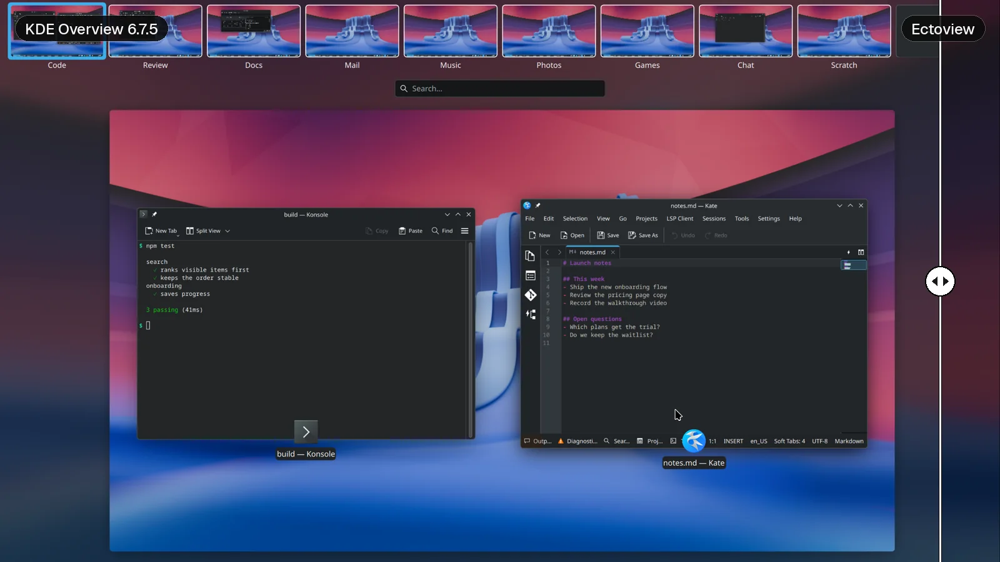
</p>

## Desktop groups

Sort your desktops by what they're for. The bar shows one group at a time: its desktops,
and the desktop you're on even when it's in another group. The groups' button left of the
search field names the group shown and opens the list of them.

<p align="center">
  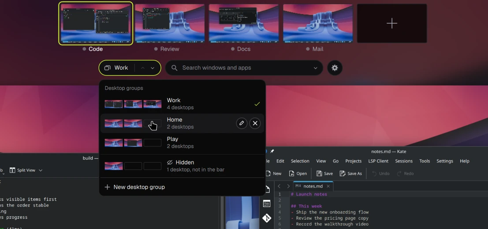
</p>

- **Choose a group** from the list, and you go to the desktop you last used in it.
- **Make, rename, reorder and remove** groups in the list: New desktop group at its foot,
  the pencil and the cross on a row as you point at it, and a row dragged up or down.
  Removing a group moves its desktops to the first group; nothing is deleted.
- **Put a desktop in a group** by dragging it from the bar onto the groups' button and then
  onto a group's row, or with the move button on a desktop in the bar.

<p align="center">
  
</p>

### Step through groups

^ and v at the right end of the groups' button step to the previous and next group, at the
same place whatever the group is called. At the first or last group, the arrow with nowhere
to go dims. Groups are a list from top to bottom, so a group change moves up and down: going to
the next group, the bar's desktops and the big view slide up and away as the next group's
slide up into place; going back, they slide down.

Four shortcuts, with no keys until you give them some in the settings: Next and Previous
Desktop Group, and Next and Previous Desktop in Desktop Group. They work with Ectoview
closed too. With it closed, a group shortcut slides the whole screen up to the next group's
desktop (down to the previous group's), the way a group changes in Ectoview, instead of KWin
sliding the screen sideways past every desktop between.

<p align="center">
  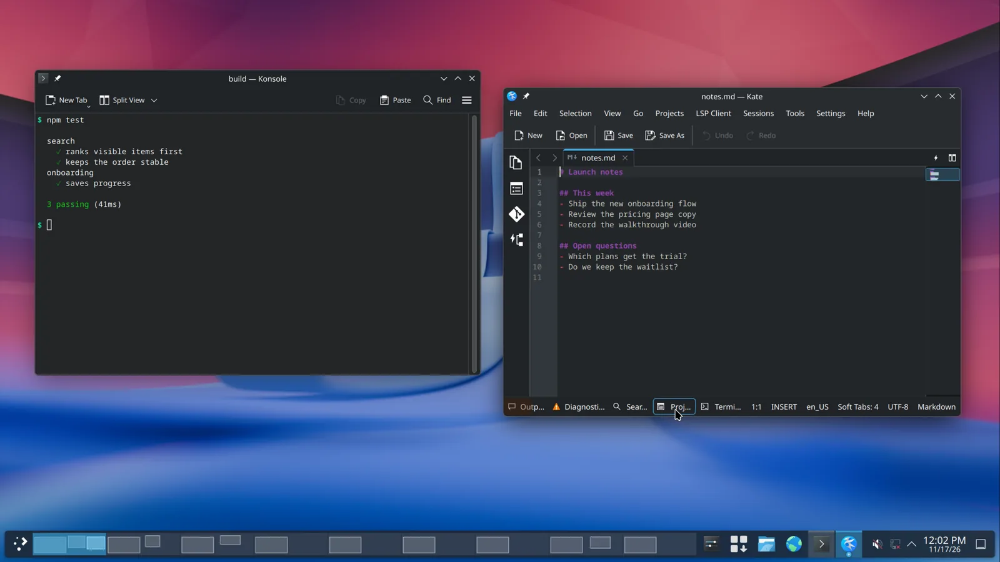
</p>

### Hidden desktops

Hidden is a group of its own: its desktops stay out of the bar and out of Grid View until
you choose Hidden in the list. The desktop you're on still shows in the bar, dimmed, with a
badge saying where it lives.

### Grid View, by group

Grid View lays your desktops out a row per group, each headed with its group's name, and
sits in the middle of the screen. A group with more desktops than fit in a row wraps onto
more rows, lined up in columns, so the desktops are drawn as big as the screen allows: on an
ultrawide screen, a group of eleven takes two rows of six and five. Drop a desktop on
another group's rows to move it to that group.

<p align="center">
  
</p>

### Search what you're working on

The caret at the end of the search field picks what search looks through: this desktop,
this group, or all desktops. KRunner's results for apps, files and more come after the
windows, as in Overview.

## Notification beacons

Every desktop has a dot left of its name. It's grey, and it lights in your accent with a
ring swelling from it when a window on that desktop asks for your attention. That's the
flag that makes a window's taskbar entry light up, so any app that asks for you lights its
desktop's dot, whatever the app. The dot goes out when you go to the window.

A desktop in a group you aren't looking at lights the groups' button, and its group's row
in the list. Hidden desktops stay quiet: what you put there was put out of the way, so it
lights nothing.

<p align="center">
  
</p>

## Moving desktops and windows

### Drag desktops into order

Drag a desktop along the bar and the others slide aside. Let go, and it moves in KWin's
own order, so the desktop switcher and the shortcuts follow. Near the bar's end it scrolls
along.

<p align="center">
  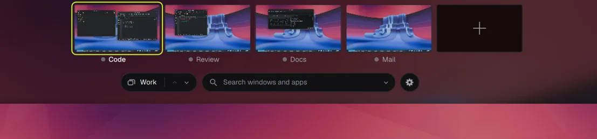
</p>

### Carry a window to another desktop

Drag a window onto a desktop in the bar, as in Overview, or onto a group's row in the list:
it goes to that group's desktop, and you with it. Hold a window on the < or > beside the
big view, and after a pause the view moves to the next desktop in the group, carrying it.
Let go there. A click on an arrow goes to that desktop. If you'd rather not have the arrows,
turn them off in the settings: the view then takes their room.

<p align="center">
   at the right of the big view. After a pause the view slides on to the next desktop with the window still under the pointer, and it's let go there">
</p>

<p align="center">
  
</p>

### Many desktops

With more desktops than fit, < and > at the bar's ends page along it, and its ends fade
into the backdrop instead of stopping at a hard edge. The bar follows the desktop you
switch to.

<p align="center">
  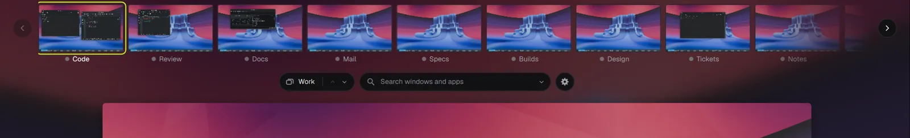 at its right end pages along, then the < pages back">
</p>

## Your screens

Ectoview always opens in full on your primary screen. For your other screens, its settings
give you three choices:

- **All of Ectoview,** the same as on the primary screen. This is what Overview does.
- **Only their windows:** each screen spreads out its own windows, without the desktop bar
  or the toolbar.
- **Nothing:** the screen stays exactly as it is, so a screen you keep as a dashboard is
  never covered. Clicks there do nothing until Ectoview closes.

<p align="center">
  
</p>

## The scroll wheel and clicks

- **The wheel switches desktops only over the bar.** Over the big view it scrolls nothing,
  and a turn of the wheel just as Ectoview closes no longer switches you to another
  desktop.
- **Clicks that mean it.** Only a click on a desktop or a window takes you somewhere. A
  click on the backdrop around the view, or on a faded arrow, does nothing, so a near miss
  doesn't close Ectoview.

## Ecto's look, or KDE's

Ectoview comes in Ecto's dark look, in Geist, with Ecto green where you are. Or in your KDE
colors and font. Pick the accent (Ecto green, your KDE accent or a color of your own) and
how dark the backdrop gets.

<p align="center">
  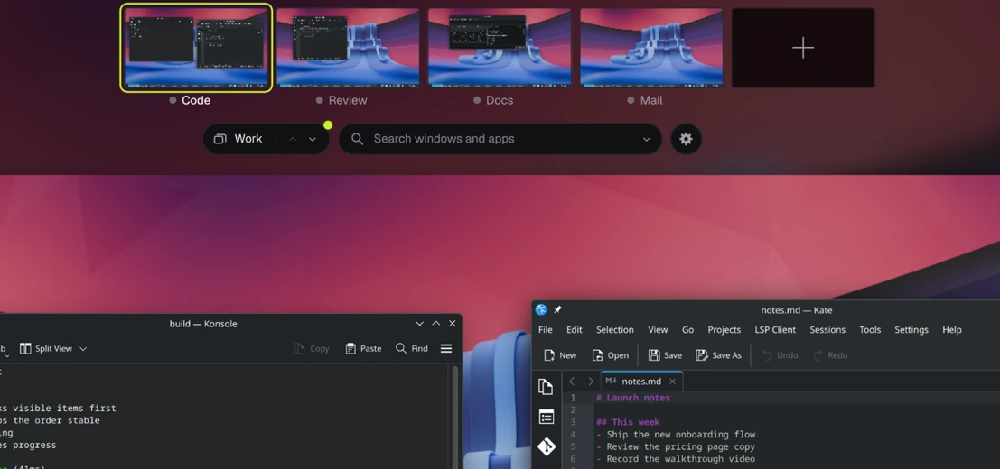
  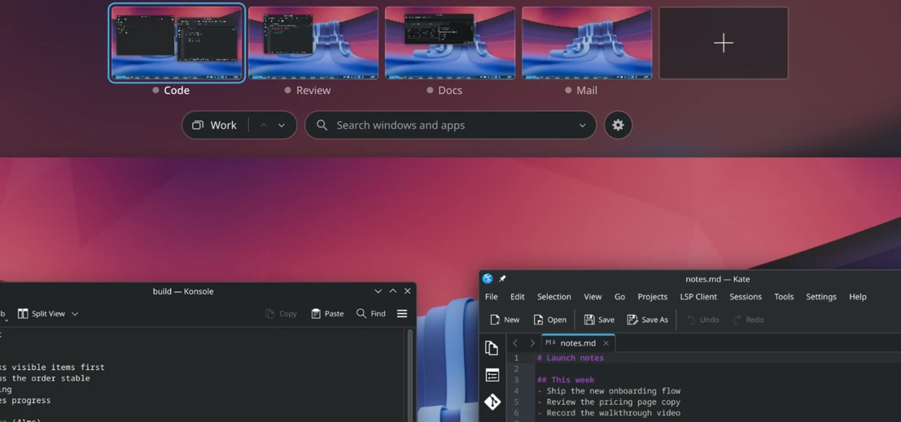
</p>

### Where the bar sits

The bar goes along the top, bottom, left or right, and the toolbar can go: then the groups'
button and the gear sit at the bar's end. With the bar on a side, the view keeps room for its
arrows, so each sits in its own gap, clear of the bar and of the screen's edge.

<table>
  <tr>
    <td width="50%">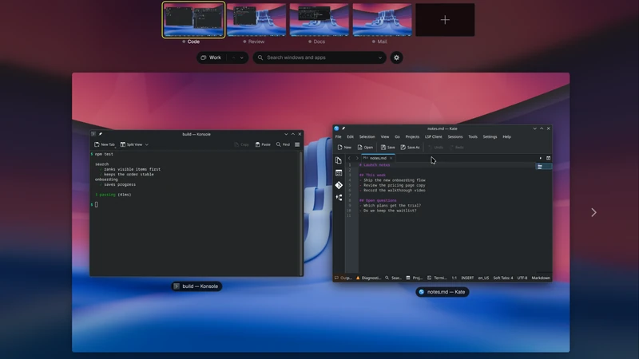<br><sub><b>Top,</b> with the toolbar</sub></td>
    <td width="50%">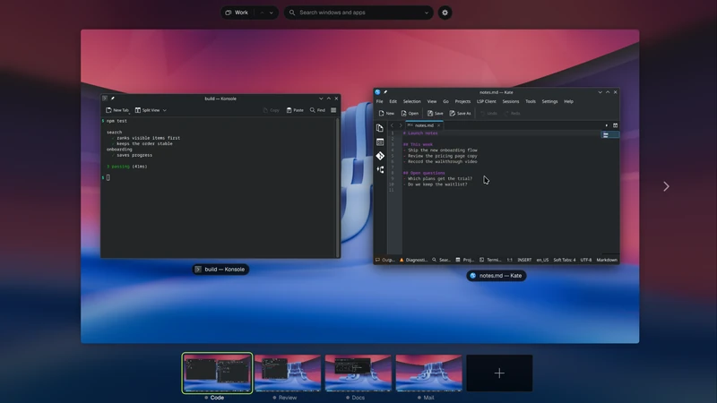<br><sub><b>Bottom,</b> with the toolbar at the top</sub></td>
  </tr>
  <tr>
    <td width="50%">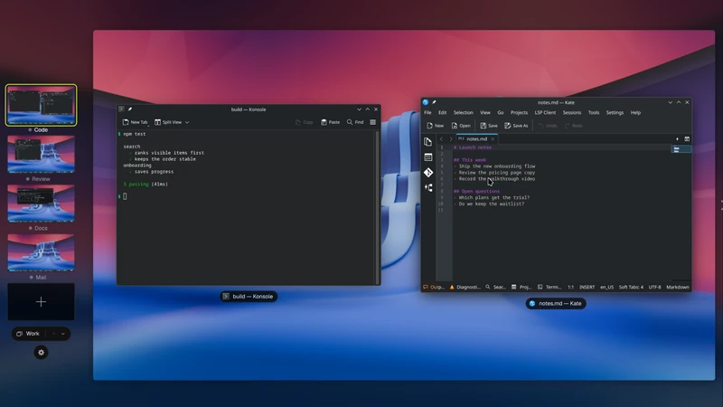 between the view and the screen's edge"><br><sub><b>Left,</b> without the toolbar</sub></td>
    <td width="50%">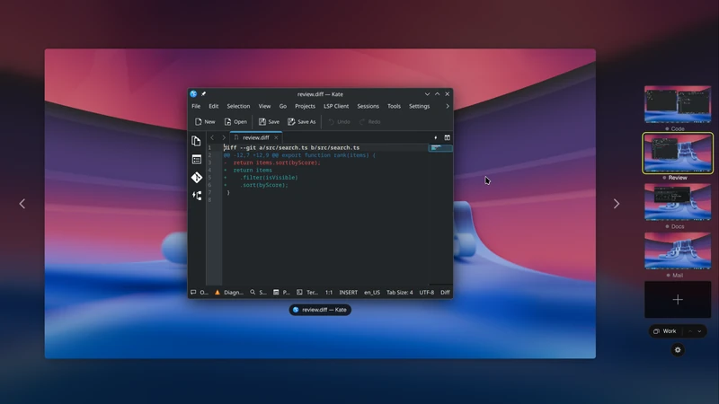 between the view and the bar"><br><sub><b>Right,</b> without the toolbar</sub></td>
  </tr>
</table>

## Settings

The gear beside the search field opens Ectoview's settings, also in System Settings under
Window Management, Desktop Effects. Two tabs:

- **General:** the look, the accent, the backdrop's darkness, where the bar sits, the
  toolbar, the arrows beside the desktop view, what the other screens show, and KWin's own
  Switch desktops independently for each screen.
- **Shortcuts:** Ectoview's own, with KWin's one-desktop switches (left, right, up and
  down) beside them, like items together.

Desktop groups aren't in the settings: you make and change them in Ectoview itself, where
your desktops are in sight.

## Status

Ectoview 1.0, for KDE Plasma 6.7 and 6.8 on Wayland. It's tested in a private, off-screen
KWin, never on the desktop you're using: every feature above has a scenario that drives it
with a real pointer and keys and checks what's drawn, on Plasma 6.7 and, in a container,
on Plasma 6.8. Installing and removing it are checked as a new user on Fedora, openSUSE
Tumbleweed, Arch, Debian testing and KDE neon. What isn't done yet is in
[docs/deferred.md](docs/deferred.md).

## Installing

### Fedora: the package

On Fedora 44 and 45, install the package from COPR, then turn Ectoview on in your Plasma
session:

```bash
sudo dnf copr enable omgrant/ectoview
sudo dnf install ectoview
ectoview-setup on
```

`ectoview-setup on` turns Overview off and Ectoview on, and moves Overview's shortcuts
(Meta+W, Meta+G and the cycle keys) to Ectoview. `ectoview-setup off` puts Overview back,
with its shortcuts; run it before `sudo dnf remove ectoview`.

### Any distribution: from source

You need KDE Plasma 6.7 or newer on Wayland. `install.sh` checks, then finds what the build
needs and shows your package manager's command to install it, running it only if you say
yes (it knows Fedora, openSUSE, Arch, Debian, Ubuntu and KDE neon):

```bash
git clone https://github.com/Ectonomic/Ectoview.git
cd Ectoview
./install.sh
```

`install.sh`, with no root but for that one package command:

1. builds the settings page and installs it under `~/.local`;
2. installs the effect where your KWin looks for it, in `~/.local/share/kwin/effects`
   (`kwin-wayland/effects` on Plasma 6.7);
3. tells the Plasma session where the settings page is, so System Settings finds it after
   you log out and in once (the gear finds it straight away);
4. turns Overview off and Ectoview on, carrying Overview's settings over;
5. moves Overview's shortcuts (Meta+W, Meta+G and the cycle keys) and screen edges to
   Ectoview.

Everything it changes is recorded in `~/.local/state/ectoview-install`. Run it again to
update: your settings and shortcuts stay, and the new build runs the next time you open
Ectoview, no logging out. `./uninstall.sh` puts Overview back, with its shortcuts.

## How it's built and tested

- `package/` is the effect: QML, loaded by KWin, Overview's views forked from KWin 6.7.5.
- `kcm/` is the settings page, C++ on KDE Frameworks 6, its settings generated from the
  effect's own `package/contents/config/main.xml` so the two can't drift.
- `tests/e2e/run.sh` runs a scenario in a headless KWin with its own D-Bus, Plasma and a
  fresh home, Ectoview installed as a stranger would install it: `SCENARIO=groups
  tests/e2e/run.sh OUT`. Each scenario checks what's drawn and what KWin holds, and fails on
  a QML error or a black screen. Planted faults (`SCENARIO=plant-…`) prove the checks catch
  what they guard.
- `tests/e2e/container.sh OUT SCENARIO …` runs the same scenarios inside a Fedora container,
  on that distribution's Plasma (6.8 on Fedora 44).
- `tests/install/stranger-check.sh` installs and removes Ectoview as a new user in clean
  containers of Fedora, openSUSE Tumbleweed, Arch, Debian and KDE neon, and checks that a
  Plasma older than 6.7 is refused with nothing changed; `tests/install/rpm-check.sh`
  builds the Fedora package as COPR does and checks it the same way.
- `tools/readme-pictures.sh` films this README's pictures in that same headless KWin.

## Staying close to KDE

`upstream/` holds Overview and the parts of KWin and Milou that Ectoview forks, untouched,
from KWin 6.7.5 and Plasma 6.7.5: diff against it to see every change Ectoview makes.

## License and credits

Ectoview is free software under the GNU General Public License, version 2 or later, as
KWin is: see [LICENSES/](LICENSES/). It's built from KWin's Overview by Vlad Zahorodnii and
KWin's contributors, and Milou's search results by its contributors. Geist is by Vercel,
under the SIL Open Font License. The wallpaper in the pictures is KDE Plasma's Waterfall by
Krystian Zajdel, under CC BY-SA 4.0.
